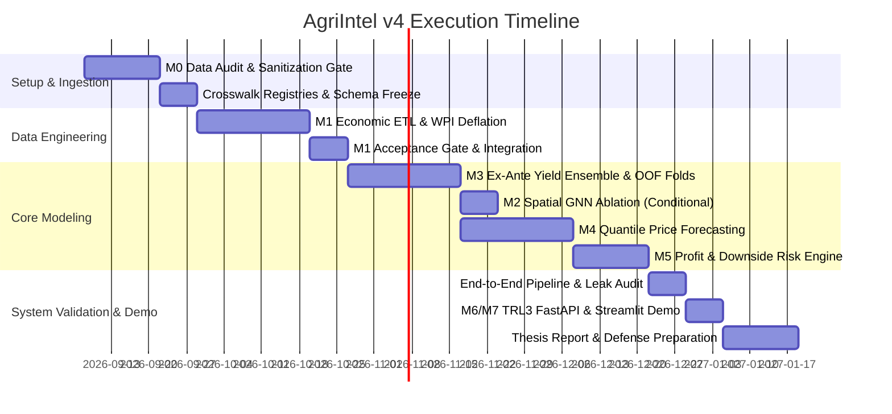

# AgriIntel — Project Plan (v4, Rigorous Specification)
### AI-Powered Crop Profit Forecasting & Decision-Support System

**Status:** Build-ready academic and engineering specification. Refined from v3 through empirical data audit of `agriIntel_merged_final_v.csv` and systematic stress-testing across modularity, verification & validation, defensive engineering, and academic integrity.

---

## 0. Executive Summary & Audit Baseline

AgriIntel predicts district-crop-season yield, forecasts real harvest-time prices with calibrated uncertainty, and derives a risk-adjusted, profit-ranked crop recommendation for farmers at planting time.

### 0.1 Empirical Findings from the Agronomic Dataset (`agriIntel_merged_final_v.csv`)
An audit of the starting dataset (95,674 rows × 29 columns across 5 states, 213 districts, 45 crops, 2000–2019) revealed four structural realities that v3 overlooked:
1. **Denominators & Scaling Artifacts:** `irrigation_intensity` has extreme recording errors up to 408.4 (e.g. Anuppur 2002-03, where district cropped area was misrecorded as 9 ha while irrigated area was 3,676 ha). 1,596 rows report intensity > 1.0.
2. **Biological Yield Dispersion:** Yield varies by three orders of magnitude across crop species (Sugarcane median 57.8 t/ha vs Cardamom 0.09 t/ha; Pulses ~0.45 t/ha). Pooled metrics are meaningless; crop-stratified modeling is mandatory.
3. **Data Hygiene:** 1 exact duplicate row exists; 175 rows report zero production/yield on positive acreage (crop failure vs recording gap); soil nutrient indices have localized missingness (Nitrogen: 1,422 NAs / 1.49%).
4. **Information Timing:** Seasonal rainfall (`Rainfall_mm`, `Heavy_Rain_Days`) is an *ex-post* aggregate. Feeding realized rainfall into a *pre-sowing* recommendation engine creates a fatal temporal leakage.

---

## 1. Project Scope & Methodological Foundations

### 1.1 Primary Objectives
Given district, soil profile, historical climate, and planting season:
1. Generate an **ex-ante yield forecast** with uncertainty bounds (calibrated variance).
2. Generate an **inflation-adjusted harvest price forecast** (P10, P50, P90 quantiles) conditioned on macro WPI and historical seasonal arrivals.
3. Produce a **risk-aware, profit-ranked crop recommendation** evaluated on held-out years and held-out districts.

### 1.2 Core Methodological Corrections (Academic Integrity)

| Dimension | v3 Pitfall | v4 Rigorous Methodology | Academic Rationale |
|---|---|---|---|
| **Temporal Alignment** | Realized seasonal rainfall used to recommend crops at sowing time. | Two strictly decoupled pipelines: **Mode A (Ex-Ante Sowing Decision)** uses historical climate normals & pre-season indicators; **Mode B (In-Season Monitoring)** uses realized weather. | Sowing decisions occur in June/October before monsoon rainfall occurs. Using full-season rainfall is future-data leakage. |
| **Price Valuation** | Nominal prices modeled across 2000–2020. | All AGMARKNET prices deflated to **Real Prices (Base 2011-12 = 100)** via RBI Wholesale Price Index (WPI) before modeling. | A 300% nominal price rise over 20 years reflects currency inflation, not crop demand/supply dynamics. |
| **MSP Handling** | Artificial post-hoc hard clipping to MSP floor. | MSP incorporated as an **informative feature and economic benchmark**, never an artificial hard clip on market price. | Market prices for pulses/oilseeds frequently trade 15–30% below MSP where state procurement is absent. Clipping blinds farmers to real downside risk. |
| **Crosswalk Curation** | Ad-hoc Python dictionaries and inline string overrides. | **External Declarative Registry:** Versioned CSVs (`mandi_map.csv`, `crop_alias_map.csv`) with audit provenance (match method, confidence score, reviewer). | Eliminates arbitrary hardcoding; ensures 100% reproducible gazetteer resolution. |

---

## 2. System Architecture & Modularity

To eliminate monolithic scripts and enable isolated unit debugging, the pipeline is decomposed into independent, single-responsibility submodules.

```
agriintel/
├── config/
│   ├── pipeline.yaml                 # Master configuration (no inline constants)
│   └── schemas/                      # Typed Pandera schema definitions
│       ├── agronomic_schema.py
│       ├── economic_schema.py
│       └── recommendation_schema.py
├── crosswalks/                       # Version-controlled, audited mapping tables
│   ├── crop_alias_registry.csv
│   ├── mandi_district_registry.csv
│   └── resolver.py                   # Deterministic lookup engine (no hardcoded dicts)
├── data/
│   ├── raw_snapshots/                # Hash-stamped immutable raw inputs
│   ├── quarantine/                   # Quarantined rows with error diagnostic codes
│   └── processed/                    # Parquet outputs per module seam
├── modules/
│   ├── m0_audit_gate/                # Ingestion validation & data hygiene for frozen store
│   │   ├── audit_checks.py
│   │   └── sanitizer.py
│   ├── m1_economic_etl/
│   │   ├── extractors/               # Isolated fetchers: agmarknet.py, des.py, wpi.py, msp.py
│   │   ├── normalizer.py             # WPI deflation & real-price conversion
│   │   └── aggregators.py            # Seasonal arrival-weighted price aggregation
│   ├── m2_spatial/                   # Spatial graph construction & ablation
│   │   ├── graph_builder.py
│   │   └── gnn_ablation.py
│   ├── m3_yield/
│   │   ├── features.py               # Lag generation & rolling climate feature store
│   │   ├── baselines.py              # Hierarchical trailing-mean baseline
│   │   └── ensemble.py               # XGBoost/LightGBM with Optuna & calibrated variance
│   ├── m4_price/
│   │   ├── quantile_regressor.py     # Simultaneous / monotonic quantile LightGBM
│   │   ├── non_crossing.py           # Chernozhukov rearrangement operator
│   │   └── baselines.py              # Seasonal-naive & ARIMA baselines
│   ├── m5_profit/
│   │   ├── engine.py                 # Deterministic profit distribution convolution
│   │   └── ranker.py                 # Risk-adjusted ranking (Expected Profit - λ*Risk)
│   └── m6_demo/                      # Minimal TRL3 FastAPI + Streamlit demonstrator
├── tests/
│   ├── test_m0_hygiene.py
│   ├── test_crosswalk_integrity.py
│   ├── test_leak_prevention.py       # Strict temporal-spatial index isolation tests
│   ├── test_property_based.py        # Hypothesis invariant tests
│   └── test_golden_master.py
└── logs/
```

### 2.1 Standardized Module Contract (`PipelineModule`)

Every module strictly implements the abstract base contract:
```python
from abc import ABC, abstractmethod
import pandera.polars as pa  # or pandera.typing.DataFrame

class PipelineModule(ABC):
    @abstractmethod
    def validate_input(self, data: pa.DataFrame) -> None:
        """Enforces schema, valid ranges, and absence of target/temporal leaks."""
        pass

    @abstractmethod
    def run(self, data: pa.DataFrame, config: dict) -> pa.DataFrame:
        """Pure deterministic transformation. No global state side effects."""
        pass

    @abstractmethod
    def validate_output(self, result: pa.DataFrame) -> None:
        """Validates output schema, absence of nulls, and boundary invariants."""
        pass

    @abstractmethod
    def run_from_disk(self, in_uri: str, out_uri: str, config_uri: str) -> None:
        """CLI entrypoint enabling isolated execution and debugging."""
        pass
```

---

## 3. Data Architecture & Defensive Engineering

### 3.1 Module 0: Agronomic Data Hygiene & Sanitization Gate
Before Module 1 touches the "frozen" agronomic table, Module 0 executes automated sanitization to resolve empirical defects:
1. **Deduplication:** Remove exact duplicate rows (e.g. Tirunelveli Castor seed 2019-20) and assert unique key constraint on `[State, District, Crop, Year, Season]`.
2. **Irrigation Intensity Bounding:**
   $$\text{irrigation\_intensity} = \min\left(\frac{\text{total\_irrigated\_ha}}{\max(\text{total\_cropped\_area}, \text{total\_irrigated\_ha})}, 1.0\right)$$
   Records where `total_cropped_area < total_irrigated_ha` are corrected via the physical ceiling and logged to `data/quarantine/m0_clipping_audit.log`.
3. **Soil Missingness Imputation with Provenance:**
   - Missing N-P-K indices (e.g., 1,422 missing Nitrogen records) are imputed via **District Historical Median**, falling back to **State Agro-Climatic Zone Median**.
   - Every imputed record is explicitly tagged: `is_soil_imputed = True`, preserving complete data provenance.
4. **Zero Production / Acreage Outliers:**
   - Rows where `Area > 0` and `Production == 0` are flagged with `crop_failure_flag = True` rather than silently distorting normal yield distributions.

### 3.2 Defensive Quarantine Architecture
Rather than hard-failing pipelines or silently dropping malformed data, AgriIntel uses an explicit **Quarantine Pattern**:
- Malformed rows (unmatched mandis, negative areas, unresolvable crop aliases) are piped to `data/quarantine/{module_name}_rejected.parquet`.
- Each quarantined record carries:
  `[timestamp, original_payload, error_code, rejection_reason]`.
- The pipeline proceeds if `rejection_rate <= 2.0%`; otherwise, an automated circuit breaker halts execution.

### 3.3 AGMARKNET Seasonal Price Aggregation
Raw mandi records are aggregated to crop-season grain using **Arrival-Weighted Mean Real Price**:
$$\bar{P}_{\text{real}} = \frac{\sum_{i \in \text{Mandi}} \sum_{t \in \text{Season}} (\text{Price}_{i,t} / \text{WPI}_t \times 100) \times \text{Arrivals}_{i,t}}{\sum_{i \in \text{Mandi}} \sum_{t \in \text{Season}} \text{Arrivals}_{i,t}}$$

**Hierarchical Spatial Fallback (Circuit Breaker):**
If a district reports zero arrivals for a crop in a season:
1. Level 0: District Mandi Arrival-Weighted Average.
2. Level 1: Neighboring District (Contiguous Agro-Climatic Cluster) Average.
3. Level 2: State-Level Seasonal Crop Average.
All rows record `price_imputation_level ∈ {0, 1, 2}`.

---

## 4. Verification & Validation (V&V) Matrix

| Module | Deterministic / Property Checks | Cross-Validation Strategy | Acceptance Gate |
|---|---|---|---|
| **M0: Audit Gate** | • Zero duplicate composite keys<br>• `irrigation_intensity ∈ [0.0, 1.0]`<br>• `Yield == Production / Area` within $10^{-6}$ | N/A (Sanitization & schema validation) | 100% schema conformance; quarantine rate < 0.1% |
| **M1: Economic ETL** | • Real price $> 0$<br>• Zero unmapped crop aliases<br>• WPI month alignment verified | N/A (Deterministic aggregation) | $\ge 98\%$ mandi-district match rate; zero silent nulls; fallback level 2 $< 5\%$ |
| **M2: Spatial Graph** | • Adjacency matrix symmetry<br>• Zero disconnected/orphan nodes<br>• Embedding variance non-zero | Spatial cross-validation (Leave-One-Region-Out) | Ablation must beat tabular M3 RMSE by $\ge 3\%$ out-of-sample, or GNN is dropped |
| **M3: Ex-Ante Yield** | • Biological boundary: $\text{Yield} \le \text{MaxBio}_{\text{crop}}$<br>• Non-negative predictions ($\hat{y} \ge 0$)<br>• Calibrated variance ($\sigma^2 > 0$) | Rolling-origin temporal walk-forward (train $\le T$, test $T+1$) nested with Leave-One-District-Out | Beats hierarchical trailing-3yr mean baseline RMSE by $\ge 10\%$ per major crop family |
| **M4: Real Price Quantiles** | • Monotonicity: $\hat{q}_{10} \le \hat{q}_{50} \le \hat{q}_{90}$ via rearrangement<br>• Empirical coverage on held-out data | Rolling-origin walk-forward; strictly out-of-sample WPI scenarios | Beats seasonal-naive pinball loss; empirical 80% coverage within $[75\%, 85\%]$ |
| **M5: Profit & Ranking** | • Invariant: $\frac{\partial \text{Profit}}{\partial P} > 0, \frac{\partial \text{Profit}}{\partial C} < 0$<br>• Golden master deterministic tests | Historical backtest on realized profit across held-out years | NDCG@3 $\ge 0.70$; Top-1 recommended crop ranks in realized Top-3 $\ge 70\%$ of seasons |
| **M6/M7: Demo** | • FastAPI Pydantic schema validation<br>• Response latency $< 500$ ms | Deterministic parameter sweep (20 test queries across all 5 states) | $100\%$ valid JSON payload delivery; zero server 500 errors |

---

## 5. Detailed Module Specifications

### Module 0 — Ingestion Hygiene & Agronomic Audit Gate
* **Goal:** Sanitize `agriIntel_merged_final_v.csv`, cap physical bounds, impute soil gaps with provenance tracking, and emit a verified, immutable baseline.
* **Input:** Raw `agriIntel_merged_final_v.csv`.
* **Output:** `agronomic_cleaned_v4.parquet`, `m0_audit_manifest.json`.
* **Defensive Rules:** Quarantine duplicate keys; cap `irrigation_intensity` at 1.0; enforce strict non-null keys.

### Module 1 — Economic Data Layer & Real-Price Normalization
* **Goal:** Ingest AGMARKNET daily arrivals, DES cultivation costs, RBI WPI, and MSP. Canonicalize entities using declarative registries and compute seasonal real prices.
* **Outputs:** `fact_economic_seasonal.parquet`, `dim_cultivation_cost.parquet`, `dim_msp.parquet`.
* **Academic Safeguard:** All prices adjusted by WPI. All entity resolution handled through `crosswalks/` tables with complete audit trails.

### Module 2 — Spatial Embeddings (Conditional Ablation)
* **Goal:** Test whether Graph Neural Network (GAT/GraphSAGE) district embeddings capture spatial autocorrelation of yield better than spatial coordinates/district fixed-effects.
* **Ablation Protocol:** Train identical M3 models with vs. without GNN embeddings across identical rolling temporal folds.
* **Gate:** If out-of-sample RMSE reduction is $< 3\%$, the GNN is formally dropped, and the negative result is documented as a chapter finding.

### Module 3 — Ex-Ante Yield Forecasting Ensemble
* **Goal:** Predict crop yield prior to harvest using historical climatological patterns, soil indices, and irrigation infrastructure.
* **Architecture:** LightGBM / XGBoost with Optuna hyperparameter optimization. Uncertainty estimated via Conformal Prediction or Quantile Gradient Boosting.
* **Strict Anti-Leak Rule:** To prevent temporal leakage into M4/M5, all yield predictions fed to downstream modules must be **Temporally Out-of-Fold (OOF)** predictions generated exclusively from models trained on prior years.

### Module 4 — Real Price Forecasting with Quantile Calibration
* **Goal:** Forecast real harvest price distributions ($q_{10}, q_{50}, q_{90}$) conditioned on seasonal historical arrivals, crop acreage, and macro WPI trend.
* **Non-Crossing Guarantee:** If independent quantile regressors yield crossings ($\hat{q}_{10} > \hat{q}_{50}$), enforce sorting/rearrangement (Chernozhukov et al., 2010):
  $$\hat{\mathbf{q}} = \text{sort}([\hat{q}_{10}, \hat{q}_{50}, \hat{q}_{90}])$$
* **MSP Policy Benchmark:** Evaluate price realization against MSP. Provide a metric tracking $\mathbb{P}(\text{Price} < \text{MSP})$ as a key market downside risk indicator.

### Module 5 — Risk-Adjusted Profit Ranking
* **Goal:** Formulate expected net profit per hectare and recommend crops balancing return vs volatility.
* **Economic Formulation:**
  $$\mathbb{E}[\Pi] = (\hat{Y}_{\text{ex-ante}} \times \hat{P}_{\text{real}, 50}) - \text{Cost}_{\text{cultivation}}$$
  $$\text{Downside Risk} = (\hat{Y}_{\text{ex-ante}} \times \hat{P}_{\text{real}, 50}) - (\hat{Y}_{10} \times \hat{P}_{\text{real}, 10})$$
  $$\text{Recommendation Score} = \mathbb{E}[\Pi] - \lambda \times \text{Downside Risk}$$
  *(where $\lambda$ represents the farmer's risk-aversion parameter, configurable in `pipeline.yaml`).*
* **Evaluation:** Evaluated on historical held-out years against the standard agricultural baseline: *"Plant whatever crop had the highest realized profit in that district last year"*.

### Module 6/7 — Minimal Demonstrator (TRL3)
* **Goal:** Interactive local demonstrator enabling a user to select State, District, Season, and Land Area, returning the risk-adjusted crop leaderboard with uncertainty envelopes.
* **Stack:** FastAPI backend serving pre-computed models + lightweight Streamlit frontend. Single-command execution (`streamlit run demo.py`).

---

## 6. Execution Timeline & Milestones (20-Week Plan)



---

## 7. Hardcoded Elements vs. Audited Declarative Assets

To ensure strict academic integrity, zero business logic or entity mappings may be hardcoded into Python source code.

| Asset | Mechanism in Code | Storage Location | Audit Metadata |
|---|---|---|---|
| **Crop Name Aliases** | Loaded via `crosswalks.resolver.CropResolver` | `crosswalks/crop_alias_registry.csv` | `[raw_alias, canonical_name, source, match_score, verified_by]` |
| **Mandi to District** | Loaded via `crosswalks.resolver.MandiResolver` | `crosswalks/mandi_district_registry.csv` | `[mandi_name, state, district_census_name, distance_km, verified_by]` |
| **Biological Yield Max** | Enforced via Pandera schema check | `config/biological_yield_caps.yaml` | `[crop, max_yield_tha, agridoc_reference]` |
| **Hyperparameters** | Read at runtime via PyYAML | `config/pipeline.yaml` | Model name, search space, fold count, random seed |

---

## 8. Summary of Refinements from v3

1. **Integrated Ingestion Gate (Module 0):** Directly handles the verified data anomalies in `agriIntel_merged_final_v.csv` (duplicate rows, irrigation intensity outliers, missing soil nutrients) before downstream code runs.
2. **Fixed Temporal Leakage (Pre-Sowing Framing):** Replaced unrealistic realized seasonal weather inputs with ex-ante historical climate and pre-sowing indices, aligning with genuine agricultural decision-support constraints.
3. **Macroeconomic Real-Price Modeling:** Integrated WPI deflation to remove 20 years of monetary inflation distortion from AGMARKNET commodity prices.
4. **Economic Reality of MSP:** Eliminated misleading post-hoc clipping to MSP, establishing an honest downside risk metric when market prices crash below government support levels.
5. **Architectural Modularity & Quarantine Pattern:** Replaced monolithic scripts with decoupled functional packages and added dead-letter quarantine logging for robust, leak-free debugging.
