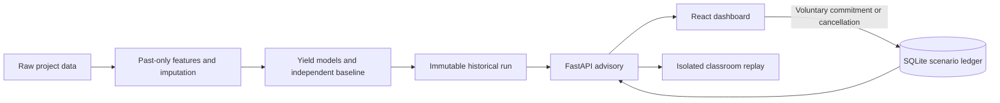

# AgriIntel

AgriIntel combines historical district-level yield estimates, transparent financial scenarios and a bounded supply-feedback demonstration. The interface retains the existing day/night landscapes and provides historical browsing for Madhya Pradesh, Maharashtra, Punjab, Tamil Nadu and Uttar Pradesh.

The integrated classroom scenario uses **Coimbatore, Kharif 2019, Ragi/Maize/Onion**. It supports planting commitments, cancellation, shared supply state and a repeatable comparison of static versus supply-aware advice.

## Evidence and limits

This is a historical/course simulation. Economic prices and cultivation costs are modeled proxies in **2011-base INR**, not observed sale proceeds, actual farm expenditure or a statutory procurement guarantee. Original source publication vintages and crop-unit provenance have not been independently verified. Historical isolation checks cannot establish present-day predictive performance or farmer income gains.

The corrected run `regional-20261015-v1` has 25,142 supported historical test records and 1,384 deliberately unavailable records across 2015–2019. Model/baseline RMSE is 3.9412/4.0408 t/ha, but MAE is 1.3541/1.2785 t/ha. Coverage of the nominal 80% intervals is 78.92%/80.93%. Neither model is uniformly best. See the active run's `metrics.json` for counts and crop/state/year breakdowns.

The seed-42 classroom replay gives static/supply-aware final scenario profit of **₹739,263.41 / ₹735,940.44**; both allocate all 24 participants. The dynamic policy loses in this example. These are simulated outcomes under identical capacity and final-price rules, not measured income. Lower-tail profit describes the lowest 10% of allocated participants; unallocated area and rejected participants are reported separately.

## Setup and verified commands

The verified environment uses Python 3.14.4 and Node 26.7.0. The checked environment is recorded in each model manifest and the release verification log. From the repository root:

```sh
python3 -m venv .venv
.venv/bin/python -m pip install -r requirements.txt
npm --prefix frontend ci
```

The validated `regional-20261015-v1` run, including its forecast table, model bundles and integrity manifest, is included in the repository. A fresh checkout can verify and run it after installing dependencies. To regenerate a separate run from the raw project CSV and saved price/CPI registries, choose an unused name; existing runs are never overwritten:

```sh
.venv/bin/python -m modules.regional_data.train --run-id regional-local-001
./scripts/verify_regional.sh
```

`verify_regional.sh` runs all Python tests, checks saved artifact hashes, and runs frontend lint, arithmetic/request-guard tests and production build. It does not start servers or retrain. `./scripts/verify_regional.sh --legacy-r` additionally runs the retained R tests; these require R packages `testthat`, `data.table` and `jsonlite` and inspect historical sanitization artifacts, not the replacement raw-to-model pipeline.

Start the API in one terminal and the frontend in another:

```sh
.venv/bin/python -m uvicorn backend.main:app --host 127.0.0.1 --port 8001
```

```sh
VITE_API_BASE_URL=http://127.0.0.1:8001/api npm --prefix frontend run dev -- --host 127.0.0.1 --port 5174
```

Open http://127.0.0.1:5174. These ports avoid replacing a pre-existing server on port 8000. Production hosting and authenticated farmer accounts are outside this release.

## Classroom workflow

1. Browse a state/district/season in **Historical explorer** and request recommendations. Unavailable records do not acquire invented zeros.
2. Select **Coimbatore classroom scenario**. The supply inputs are synthetic: 40 ha reference area per crop, 80% outside supply, and 24 participating hectares.
3. Use the generated demo participant identity. A second browser/session can use another identity. These are classroom identifiers, not authenticated accounts.
4. Request advice and commit one eligible crop. Reading advice does not reserve acreage. Quotes expire after five minutes and are invalidated by a ledger revision change.
5. Observe expected production and conservative capacity usage separately. Another visible session checks the revision every two seconds. Cancel a commitment to release exactly its recorded quantities.
6. Start an isolated replay and step, play or pause it. Both policies use the same constraints; static ranking retains its initial order, while dynamic ranking recomputes prices and scores. Final outcomes reprice every participant at that policy's common final market price.

Changing the seed reorders equal-area participants. It changes identities assigned to choices, but does not establish robustness to heterogeneous farms or change aggregate demand. A yield slider is an interpolation illustration at a fixed central price and fixed cultivation cost, not an additional calibrated probability estimate.

For a reproducible replay without a browser (choose a new output directory):

```sh
.venv/bin/python -m modules.regional.cli replay --seed 42 --output-dir output/regional_demo/my-replay
```

This retains the complete replay, policy summaries and SQLite database in the output directory.

## Architecture and persistence



All profit calculations use `area × (10 × yield × price − cost per hectare)`. Central and pessimistic combinations produce scenario values, not a mean or profit quantile. Supply-aware ranking uses central profit minus 0.5 times its downside gap. Crop prices respond to outside supply plus committed expected production plus the candidate planting. Capacity reserves upper-yield production; this is a conservative simulation rule without a market guarantee.

The ledger uses SQLite WAL, full synchronous writes and atomic transactions. Successful responses follow persistence. Idempotency prevents accepted retries from duplicating commitments. One participant can have one active commitment in each scenario; cancel before changing crops. Requests never take yield or monetary values supplied by the browser as authoritative inputs.

`AGRIINTEL_ACTIVE_RUN` can select another complete active-pointer JSON. `AGRIINTEL_DB_PATH` selects a separate database; the default is `data/api_processed/regional.sqlite3`. The effective configuration and artifact determine a scenario identifier, so activating a different run/configuration preserves old scenario state. Stored-state access, accepted-request recovery and cancellation remain available even if the current forecast catalog is unavailable. Legacy JSONL events are retained but never imported into the new ledger automatically.

New endpoints live under `/api/v2`; inspect `/docs` on the API for their schemas. Historical `/api/locations` and `/api/recommendations` compatibility routes return documented historical data/canonical scenario values. Unsafe unscoped `/api/commit` and `/api/state` return HTTP 410. Historical results and legacy M4–M8 research modules remain evidence of earlier work; they are not used to establish the integrated release's correctness or market/privacy guarantees.

## Verification records

- `logs/regional_release_2026-10-15/`: final tests, artifact checks, browser flow/screenshots and independent review findings/fixes.
- `logs/regional_training_2026-10-15.log`: actual fresh training output and environment/performance warnings.
- `modules/regional_data/README.md`: raw-to-model data contracts and saved-bundle inference.
- `frontend/README.md`: browser behavior and API configuration.
- `docs/TECHNICAL_DOCUMENTATION.md`: complete architecture, methods, contracts, evaluation and limitations; a PDF copy is in `output/pdf/`.

The technical PDF is generated from the Markdown with `scripts/build_technical_pdf.py` using Pandoc and ReportLab. Its two workflow figures are rendered as vector diagrams.

Existing processed datasets, earlier metrics, JSONL events and PowerPoint/PDF deliverables are preserved. The versioned active run is included as a separate immutable release artifact; subsequent runs must use new identifiers rather than replacing its evidence.
