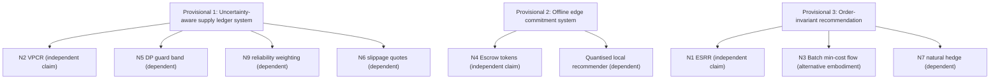

# AgriIntel — Patentable Novelty Brainstorm

**Status:** Internal brainstorm for discussion with a registered patent agent/attorney. **Not legal advice.**
**Date:** 2026-10-28
**Scope:** New algorithmic approaches derived from (and extending) the existing AgriIntel codebase.

---

## 0. Read This First — Three Hard Constraints

### 0.1 Your existing code is probably already prior art against you
The repository was pushed publicly to `github.com/lifemeansfun/AgriIntel_project` (commit `0d1f657`, Oct 2026). Anything visible there — including the README, `docs/TECHNICAL_DOCUMENTATION.md`, the PDF and the presentation — is a **public disclosure**.

| Jurisdiction | Grace period for your own disclosure | Consequence |
|---|---|---|
| **India** | Essentially none for a public GitHub release (Sec. 29–31 exceptions are narrow) | Already-published features are likely **not patentable** in India |
| **Europe (EPO)** | None (absolute novelty) | Same |
| **USA** | 12 months from first disclosure (35 U.S.C. §102(b)(1)) | US filing still possible until ~Oct 2027 |

**Action:** Do **not** publish, present, or commit any of the *new* ideas in Sections 2–3 publicly until a provisional/complete specification is filed. If the repo can be made private, ask your agent whether that helps (it usually does not cure a disclosure that already happened, but it stops further damage).

### 0.2 "Supply-aware crop recommendation" by itself is not new
A quick prior-art search shows the general concept (de-rank crops as regional commitments rise, to avoid gluts and herding) is already described in academic papers and patent-style literature. **Claims must target the specific algorithms below, not the general idea.**

### 0.3 India Section 3(k) and US *Alice*
Mathematical methods, business methods, and "computer programmes per se" are excluded in India. Under the **CRI Guidelines 2025**, a claim survives if it shows a **technical effect** (e.g., reduced bandwidth, offline consistency, bounded memory and latency, concurrency correctness, control of a physical device). "Maximise farmer profit" on its own is a business method. Each candidate below includes a **technical-effect hook** for this reason.

---

## 1. Inventory — What Exists Today (Already Disclosed)

These items are in the public repo. They are listed so the agent can separate *prior art (yours)* from *new matter*.

| ID | Existing mechanism | Location |
|---|---|---|
| E1 | Dual-quantity ledger: price uses expected (q50) supply; capacity reserves conservative (q90) supply | [ledger.py](file:///c:/Users/ARYAN/Desktop/AgriIntel/modules/regional/ledger.py), [economics.py](file:///c:/Users/ARYAN/Desktop/AgriIntel/modules/regional/economics.py) |
| E2 | Revision-bound, 5-minute-expiring advisory quotes; commit rejected if ledger revision changed | [ledger.py#L172-L236](file:///c:/Users/ARYAN/Desktop/AgriIntel/modules/regional/ledger.py#L172-L236) |
| E3 | Linear supply-elasticity price `P = P_ref·(1 + φθ(S/S_ref − 1))`, bounded | [economics.py#L37-L47](file:///c:/Users/ARYAN/Desktop/AgriIntel/modules/regional/economics.py#L37-L47) |
| E4 | Pessimistic scenario pairs individual q10 yield with the price at aggregate q90 supply | [economics.py#L72-L94](file:///c:/Users/ARYAN/Desktop/AgriIntel/modules/regional/economics.py#L72-L94) |
| E5 | Train ≤ t−2 / calibrate t−1 / test t split-conformal yield intervals with abstention when history is missing | [train.py#L208-L280](file:///c:/Users/ARYAN/Desktop/AgriIntel/modules/regional_data/train.py#L208-L280) |
| E6 | Analytic glut-threshold acreage (inverting the price curve) | [supply_ledger.py#L49-L90](file:///c:/Users/ARYAN/Desktop/AgriIntel/modules/m6_market/supply_ledger.py#L49-L90) |
| E7 | Comparative-advantage-weighted greedy allocator | [online_allocator.py](file:///c:/Users/ARYAN/Desktop/AgriIntel/modules/m7_allocator/online_allocator.py) |
| E8 | Laplace-DP aggregation of commitments; INT8 edge quantisation | [aggregator.py](file:///c:/Users/ARYAN/Desktop/AgriIntel/modules/m8_edge/aggregator.py) |
| E9 | Static vs. dynamic replay — **dynamic policy lost** (₹735,940 vs ₹739,263, seed 42) | [replay.py](file:///c:/Users/ARYAN/Desktop/AgriIntel/modules/regional/replay.py), README |

> [!IMPORTANT]
> E9 matters. The current myopic greedy "supply-aware" policy did **not** beat the static policy. Novelties N1–N3 below address the *root cause* of that loss (myopia and arrival-order dependence). They are new inventions, not refinements of the losing policy. Demonstrating that they win would also give you the experimental evidence needed for patent sufficiency.

---

## 2. Candidate Novelties (New Matter — Not Yet Disclosed)

Rating key: **Novelty** = my estimate before a professional search · **3(k) risk** = risk of exclusion in India · **Effort** = implementation and validation effort.

| # | Name | Novelty | 3(k) risk | Effort | Priority |
|---|---|---|---|---|---|
| N1 | Equilibrium-Sampled Randomised Recommendation (ESRR) | High | Medium | Medium | ★★★ |
| N2 | Variance-Pooled Correlated Capacity Reservation (VPCR) | High | Low–Med | Medium | ★★★ |
| N3 | Batch-Window Clearing with Comparative-Advantage Min-Cost Flow | Medium | Medium | Medium | ★★ |
| N4 | Escrowed Capacity Tokens for Offline Edge Commitment | High | **Low** | High | ★★★ |
| N5 | DP-Noise-Calibrated Capacity Guard Band | Medium–High | Low–Med | Low | ★★ |
| N6 | Slippage-Tolerant Advisory Quotes | Medium | Medium | Low | ★★ |
| N7 | Natural-Hedge-Aware Downside Score (spatial copula) | Medium | High | Medium | ★ |
| N8 | Hierarchical Mondrian Conformal with Certified Abstention | Low–Med | High | Medium | ★ |
| N9 | Commitment-Reliability-Weighted Ledger (decay of unrealised intents) | Medium | Medium | Medium | ★★ |

---

### N1 — Equilibrium-Sampled Randomised Recommendation (ESRR) ★★★

**Problem (observed in E9):** A sequential greedy recommender gives early arrivals the best crop and later arrivals the leftovers. It is myopic about future arrivals and depends on arrival order, which is why the dynamic policy lost.

**Core idea:** Before the planting window opens, compute the *target equilibrium crop shares* for the whole expected cohort. Then give each arriving farmer a **randomised recommendation sampled from a farmer-specific distribution**, chosen so the expected aggregate converges to the equilibrium **whatever the arrival order**.

**Algorithm sketch:**
1. Forecast cohort size `N̂` and area `Â` (from historical participation in the district and season).
2. Solve a concave potential-maximisation problem for crop area shares `x*_c` (a Wardrop/Nash equilibrium of the congestion game with prices `P_c(x_c)` from E3):
   `max_x Σ_c ∫₀^{x_c} P_c(s)·ȳ_c ds − cost_c·x_c` s.t. `Σ x_c = Â`, `x_c ≤ cap_c / y90_c`.
3. For each arriving farmer *i*, solve a small **optimal-transport** step. Find the probability vector `π_i` that maximises the farmer's comparative-advantage-weighted utility, subject to keeping the *residual* target `x*_c − committed_c` feasible for the expected remaining arrivals.
4. Sample a recommended crop from `π_i` using a **seeded, auditable PRNG** (seed = hash(scenario_id, participant_id, revision)) so the draw is reproducible and verifiable.
5. On each commit or cancel, re-solve step 2 incrementally (warm start) on the residual problem.

**Distinguishing features (claim elements):**
- Randomised recommendation distributions *derived from a precomputed congestion-game equilibrium*. This differs from deterministic de-ranking.
- An **arrival-order invariance** property: the expected allocation is independent of permutation.
- A verifiable seeded draw tied to ledger revision, so the recommendation is auditable and cannot be cherry-picked.

**Technical-effect hook:** Lower sensitivity to request ordering under concurrent access, bounded recomputation through a warm-started incremental solver, and a deterministic, verifiable audit trail.

**Evidence needed:** Run the existing replay with 100+ seeds. Show ESRR beats both static and greedy-dynamic on total profit **and** on lower-tail (bottom 10%) profit, with lower variance across seeds.

**Prior art to check:** Correlated-equilibrium recommendation (Kamenica & Gentzkow, Bayesian persuasion); "information design" in routing (Waze/Google Maps routing patents); Wardrop equilibrium routing patents. **Your differentiator** is agricultural capacity under yield uncertainty (q50/q90 dual accounting) combined with comparative advantage and a seeded verifiable draw.

---

### N2 — Variance-Pooled Correlated Capacity Reservation (VPCR) ★★★

**Problem:** E1 reserves `Σ area_i · y90_c`, the sum of individual upper quantiles. That is extremely conservative: the 90th percentile of a sum is far below the sum of 90th percentiles. The result is "phantom" capacity that is reserved but never used, and farmers are turned away unnecessarily.

**Core idea:** Reserve capacity for the **portfolio quantile** of aggregate production, using a spatial residual-correlation matrix learned from historical yield residuals.

**Algorithm sketch:**
1. From the conformal calibration residuals (E5), estimate a per-crop residual σ_i, plus a district-to-district correlation `ρ_{jk}` (shrinkage estimator, e.g., Ledoit–Wolf, over historical residuals).
2. Aggregate committed production for crop *c*: mean `μ_c = Σ a_i·y50_i`, variance `σ²_c = Σ_j Σ_k a_j a_k σ_j σ_k ρ_{jk}`.
3. Conservative committed quantity = `μ_c + z_{0.9}·σ_c` (or a Cornish–Fisher correction for skew).
4. Remaining capacity = `cap_c − outside_c − (μ_c + z σ_c)`.
5. **Incremental O(n) update:** keep the vector `v = Σ a_k σ_k ρ_{·k}` so a new commit updates σ²_c in O(n) rather than O(n²). Cancellation reverses the update exactly.

**Distinguishing features:**
- Capacity reservation computed as a *correlated portfolio quantile* instead of a sum of marginals.
- An exactly reversible incremental variance update for commit and cancel in a transactional ledger.
- Guaranteed monotone tightening as correlation rises (`ρ → 1` recovers E1 exactly), which makes it a strict generalisation.

**Technical-effect hook:** Bounded O(n) state update per transaction, and higher utilisation of a constrained physical resource (storage, cold-chain, or market capacity) at the same overflow probability.

**Evidence needed:** On historical 2015–2019 data, compare realised overflow frequency and utilisation of E1 vs. VPCR at the same nominal risk level.

---

### N3 — Batch-Window Clearing with Comparative-Advantage Min-Cost Flow ★★

**Problem:** First-come-first-served allocation is unfair to farmers with poor connectivity or who arrive late.

**Core idea:** Collect *intents* (not commitments) over a short window, for example 24 hours. Clear them as a **call auction**: a min-cost-flow assignment that maximises total comparative-advantage-weighted surplus under the capacity constraints and the price-feedback curve. Linearise the concave revenue as piecewise segments so it fits exact min-cost flow.

**Distinguishing features:**
- Piecewise-linear segmentation of the supply-elastic price curve into flow-network arc costs.
- Farmer-side **reservation ranks**: each farmer submits an ordered acceptable-crop list, and the flow enforces individual rationality (no farmer gets a crop below their stated minimum).
- A hybrid mode: batch clearing at window close, with ESRR (N1) for stragglers.

**Technical-effect hook:** Deterministic, order-independent clearing regardless of network latency, which fits low-bandwidth rural networks.

**Prior art risk:** Spectrum auctions and school-choice matching are well known. The novelty is the **endogenous price-curve linearisation combined with the q50/q90 dual capacity in a single flow formulation**.

---

### N4 — Escrowed Capacity Tokens for Offline Edge Commitment ★★★ (strongest against 3(k))

**Problem:** Village kiosks and extension-worker phones are often offline. The central ledger (E1/E2) needs connectivity, so offline commits risk over-allocating capacity when the devices reconnect.

**Core idea:** The server **pre-allocates escrow "capacity tokens"** to each edge device. Each token is a signed, bounded slice of the q90 headroom per crop. The device can then accept commitments offline without any risk of global overflow.

**Algorithm sketch:**
1. Server partitions remaining headroom `H_c` into the central pool plus per-device escrows `e_{d,c}`. Escrow sizes are set by a demand forecast per device (historical kiosk usage), using an escrow-transaction scheme with bounded counters.
2. Each escrow is signed (Ed25519) with `(scenario_id, revision, crop, e_{d,c}, expiry)`.
3. Offline device runs the **INT8-quantised** recommender (E8) locally. It accepts commits only while its local escrow suffices and appends them to a hash-chained local log.
4. On reconnect: the device uploads the hash chain. The server verifies signatures and the chain, merges the commits idempotently (reusing E2's idempotency keys), returns unused escrow, and re-balances.
5. **Escrow rebalancing:** devices with higher observed demand get more of the next allocation (bandit-style update).

**Distinguishing features:**
- Capacity escrow derived from *uncertainty-adjusted* (q90 or VPCR) headroom, not from raw counts.
- Offline recommendation using a quantised local model that is consistent with the server price curve.
- Cryptographically verifiable offline commit log merged into a transactional ledger with **guaranteed no global overflow**.

**Technical-effect hook (strong):** Distributed consistency without connectivity, bounded bandwidth, tamper evidence, and edge-device computation. These are classic recognised technical effects.

**Prior art to check:** O'Neil's escrow transactional method (1986); CRDT bounded counters (Balegas et al., 2015); mobile-payment offline tokens. **Differentiator:** escrow sized from probabilistic yield quantiles and coupled with supply-elastic pricing.

---

### N5 — DP-Noise-Calibrated Capacity Guard Band ★★

**Problem:** E8 adds Laplace noise to aggregate commitments for privacy. If the published (noisy) aggregate under-reports true commitments, the system can over-allocate.

**Core idea:** Subtract a **guard band** equal to the `(1−δ)` quantile of the noise distribution from the published headroom. Then the privacy noise provably causes overflow with probability ≤ δ. The guard band is `b = (Δ/ε)·ln(1/(2δ))` for Laplace.

**Extensions:**
- Use the **sparse-vector technique** so a new noisy value is published only when the headroom crosses a threshold. This saves privacy budget over many queries in the planting window.
- Split the privacy budget across the planting window in proportion to expected query intensity.

**Distinguishing features:** Joint calibration of the differential-privacy parameters with physical capacity-overflow probability, in a commitment ledger.

**Technical-effect hook:** A guaranteed bound on resource-overflow probability under privacy-preserving data release.

---

### N6 — Slippage-Tolerant Advisory Quotes ★★

**Problem:** E2 invalidates a quote on *any* ledger revision change. In a busy district this causes repeated "refresh advice" failures (livelock), which is especially bad over slow mobile links.

**Core idea:** Borrow the idea from automated-market-maker slippage. The farmer accepts a quote with a **tolerance τ** (for example, the central profit may fall by up to 3%). At commit time the server recomputes against the *current* revision and accepts if `|ΔScore| ≤ τ` **and** the crop ranking is unchanged within the tolerance; otherwise it rejects.

**Distinguishing features:**
- A tolerance defined on *risk-adjusted score and rank*, not on price alone.
- A rank-stability check, so the farmer never gets a commit that is no longer their top choice beyond tolerance.

**Technical-effect hook:** Fewer failed transactions and round-trips under contention, which matters on high-latency rural networks.

---

### N7 — Natural-Hedge-Aware Downside Score ★

**Observation:** E4 assumes the worst case is *low individual yield combined with low price (high aggregate supply)*. In reality, a regional drought lowers both the farmer's yield **and** aggregate supply, which **raises** price. That is a natural hedge.

**Core idea:** Estimate a Gaussian or t-copula between the farmer's yield residual and the regional aggregate-supply residual from historical spatial residuals. Compute the downside as the conditional lower-tail revenue under that joint distribution. Crops with a strong natural hedge are then penalised less.

**Caveat:** High 3(k)/*Alice* risk because it is a financial-risk computation. Pair it with N4 or N2 in a dependent claim rather than filing it alone.

---

### N8 — Hierarchical Mondrian Conformal with Certified Abstention ★

Extends E5. Calibrate conformal intervals **per crop family** (Mondrian). When a stratum has fewer calibration points than `⌈1/(1−α)⌉ − 1`, fall back up a hierarchy (crop → crop family → state → pooled), recording the level used. **Abstain** if even the pooled level is invalid. Emit a machine-readable "coverage certificate" with the level used.

**Caveat:** Mondrian and hierarchical conformal prediction are well studied. Novelty is likely weak; use this as a dependent claim.

---

### N9 — Commitment-Reliability-Weighted Ledger ★★

**Problem:** Voluntary commitments are not binding. Some farmers will not plant what they committed.

**Core idea:** Weight each commitment's contribution to expected and conservative supply by a **realisation probability** `r_i`. That probability is learned from (a) the participant's past commit-to-realisation history (Beta-Binomial posterior), and (b) time since commit (hazard decay). Optionally verify planting through satellite NDVI or crop classification, which gives a physical-sensor hook.

**Distinguishing features:** A supply ledger whose committed quantities are *probabilistically discounted* and updated through remote-sensing verification events.

**Technical-effect hook:** Integration of satellite or remote-sensing verification signals into a transactional state, which strengthens the 3(k) position.

---

## 3. Suggested Patent Portfolio Strategy

**Recommended filing order:**
1. **N4 + N2 together.** These have the strongest technical-effect story and are the most defensible under 3(k) and *Alice*.
2. **N1.** Highest commercial value, but it needs experimental proof that it fixes the E9 loss.
3. Fold the rest in as dependent claims or alternative embodiments.

---

## 4. Draft Independent Claim Skeletons (For the Agent to Refine)

**Claim A (N2 — system):**
> A computer-implemented agricultural supply ledger system comprising: a transactional datastore storing, for each crop in a region, committed cultivation areas; a forecasting module producing for each commitment a central yield estimate and a residual dispersion estimate; a correlation module storing a spatial residual-correlation matrix derived from historical forecast residuals; wherein upon receiving a commitment request the system (i) incrementally updates an aggregate production variance using a maintained cross-term vector in time linear in the number of active commitments, (ii) computes a conservative aggregate production as the mean plus a quantile multiple of the aggregate standard deviation, and (iii) atomically accepts or rejects the commitment based on whether the conservative aggregate production exceeds a capacity limit; and wherein cancellation exactly reverses said incremental update.

**Claim B (N4 — method):**
> A method of accepting crop-cultivation commitments at a plurality of intermittently connected edge devices, comprising: partitioning, at a server, an uncertainty-adjusted remaining capacity into signed escrow allocations for each device; at a device while disconnected, executing a quantised recommendation model, accepting a commitment only when the device's remaining escrow allocation covers an upper-quantile production estimate of said commitment, and appending the commitment to a hash-chained log; and upon reconnection, verifying the log and signatures, idempotently merging commitments into a central ledger, and reclaiming unused escrow, such that aggregate committed upper-quantile production never exceeds the capacity.

**Claim C (N1 — method):**
> A method of issuing crop recommendations comprising: computing target crop-area shares as an equilibrium of a congestion model in which crop price decreases with aggregate expected supply; for each requesting cultivator, computing a probability distribution over crops that maximises a cultivator-specific comparative-advantage utility subject to preserving feasibility of residual target shares for forecast future requesters; and selecting a recommended crop by a pseudo-random draw seeded deterministically from a scenario identifier, cultivator identifier and ledger revision, thereby rendering expected aggregate allocation invariant to request order and the selection independently verifiable.

---

## 5. Validation Plan Before Filing (Sufficiency Evidence)

| Novelty | Experiment | Success criterion |
|---|---|---|
| N1 | 200-seed replay, heterogeneous farm sizes/CA | Beats static **and** greedy on mean profit and bottom-10% profit; lower cross-seed variance |
| N2 | Historical backtest 2015–2019 | Same or lower overflow rate than E1 at ≥ X% higher utilisation |
| N4 | Simulated 10 kiosks, random disconnects | Zero global overflow across 10⁴ trials; bandwidth per commit measured |
| N5 | Monte-Carlo noise | Empirical overflow ≤ δ |
| N6 | Contention simulation | Failed-commit rate reduced vs. E2 with no rank violations |
| N9 | Synthetic non-realisation + NDVI proxy | Supply error reduced vs. unweighted ledger |

> [!WARNING]
> Keep all of this work in a **private** branch or repository until filing. Do not push to the public `main` branch.

---

## 6. Next Steps Checklist

- [ ] Stop further public disclosure of new ideas (private repo or branch).
- [ ] Commission a professional prior-art search (Google Patents, IPO InPASS, Espacenet, Lens.org) for N1, N2, N4.
- [ ] Prototype N2 and N4 (lowest risk, strongest technical effect) and record results with dated, signed lab notes.
- [ ] Prototype N1 and rerun the replay to see whether it fixes the E9 loss.
- [ ] File an **Indian provisional specification (Form 1 + Form 2)**. As a student or individual inventor, check fee concessions (natural person or startup or educational institution rates).
- [ ] Within 12 months: complete specification plus PCT application if international coverage is wanted (claim the US grace period for already-disclosed matter only if required).
- [ ] Check with your institution: university IP policies often claim co-ownership of student projects.

---

*Prepared from inspection of `modules/regional/*`, `modules/m6_market`, `modules/m7_allocator`, `modules/m8_edge`, `modules/m4_price`, `modules/regional_data/train.py`, README and Plan v4. Novelty ratings are engineering judgements, not a legal opinion.*
