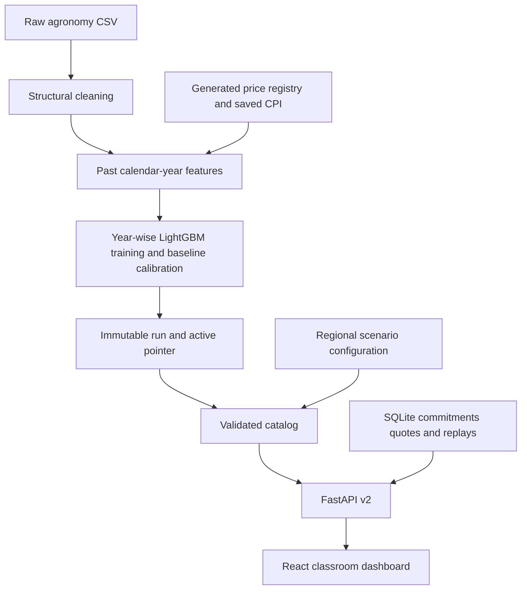
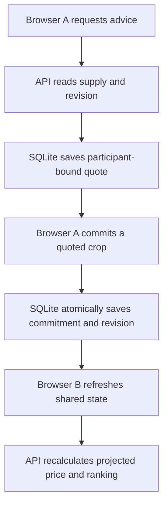

# AgriIntel: technical documentation

**Implementation reviewed:** 15 October 2026 · **Active historical run:** `regional-20261015-v1` · **Scope:** five-state historical explorer plus one Coimbatore classroom feedback scenario

**Project team, Batch 22:** Manish H (24MID0294), Anshul Singh (24MID0291), Aryan Sinha (24MID0244) · **Faculty:** Padma Priya M

AgriIntel estimates historical district/crop/season yields, combines those estimates with modeled prices and costs, and lets classroom participants commit to a crop in a shared planting scenario. A commitment changes projected supply, so later recommendations can show a different modeled price, profit and crop ranking. A separate replay compares fixed and recalculated rankings under the same rules. These are simulated planting decisions. There is no crop purchase, sale, payment, live market feed or current-season farmer deployment.

This document describes the active implementation in [`modules/regional_data`](../modules/regional_data/), [`modules/regional`](../modules/regional/), [`backend/main.py`](../backend/main.py) and [`frontend/src`](../frontend/src/). Earlier M0–M8 research modules and saved reports remain in the repository; they are not the integrated browser feedback path. The project is an academic demonstration with evidence boundaries stated below.

The retained research tree still includes M0 data hygiene, M1 economic ETL, M2 spatial analysis, M4 price modeling, M5 profit ranking, M6 supply accounting, M7 allocation/adoption and M8 edge aggregation. The active release reuses corrected M3 feature/baseline files but runs training through `modules.regional_data.train`; live recommendations and commitments use `modules.regional`. This distinction matters when reading older reports: a successful legacy module test does not prove the current browser workflow or a real-world market effect.

## 1. System boundary and components

| Component | Responsibility | Main files |
|---|---|---|
| Historical data builder | Structural cleaning, calendar-year lag features, prior-year economic proxies | [`data.py`](../modules/regional_data/data.py), [`features.py`](../modules/m3_yield/features.py) |
| Forecast training | Disjoint year folds, three yield-quantile models, interval calibration, immutable run output | [`train.py`](../modules/regional_data/train.py), [`pipeline.yaml`](../config/pipeline.yaml) |
| Historical catalog | Validates the active artifact and exposes usable locations and a configured scenario | [`catalog.py`](../modules/regional/catalog.py) |
| Shared economics | Price response, planting eligibility, profit ranking and final replay accounting | [`economics.py`](../modules/regional/economics.py), [`regional_scenario.yaml`](../config/regional_scenario.yaml) |
| Durable ledger | Quotes, commitments, cancellations, revisions, audit events and request recovery | [`ledger.py`](../modules/regional/ledger.py) |
| Policy replay | Isolated static and supply-aware policy states, stepwise decisions and final outcomes | [`replay.py`](../modules/regional/replay.py) |
| API | Validated HTTP contracts, artifact lifecycle and compatibility routes | [`main.py`](../backend/main.py) |
| Browser | Historical explorer, scenario controls, shared-state refresh, replay and day/night display | [`App.jsx`](../frontend/src/App.jsx), [`useRegionalAdvisory.js`](../frontend/src/hooks/useRegionalAdvisory.js) |



*Figure 1.* Forecast artifacts are computed offline. Browser requests use the validated artifact and a transactional SQLite scenario ledger; a browser never supplies its own trusted yield, price or cost.

The active artifact contains the 2015–2019 evaluation folds. The catalog serves usable rows from its latest year, 2019, for **Madhya Pradesh, Maharashtra, Punjab, Tamil Nadu and Uttar Pradesh**. Feedback is configured only for **Coimbatore, Tamil Nadu; Kharif 2019; Ragi, Maize and Onion**. The scenario identifier fingerprints the full effective artifact and configuration so a changed setup receives separate durable state.

## 2. Data contract and historical forecasting

The input is [`agriIntel_merged_final_v.csv`](../agriIntel_merged_final_v.csv). The unique agronomic key is `(State, District, Crop, Season, Year_start)`. The source's declared production convention is tonnes; modeled yield is `Production / Area` in tonnes per hectare. The original unit documentation and publication/release timestamps have not been independently verified. Consequently, the following is a **calendar-isolated historical evaluation**, not proof that every input was knowable before a real sowing decision.

[`structural_clean`](../modules/regional_data/data.py) drops exact duplicates, quarantines invalid keys/years/area/production, sums `Area` and `Production` within duplicate keys, and takes same-key/year medians for context fields. It leaves missing context values missing. Irrigation intensity outside `[0, 2.5]` and canal share outside `[0, 1]` become missing. In the active run, the audit records **95,674 raw rows**, one exact duplicate removed, five colliding keys aggregated, zero quarantined rows, **95,668 structural rows**, and 44 invalid irrigation values marked missing. These figures are from [`structural_audit.json`](../data/runs/regional-20261015-v1/structural_audit.json), not an independent source-data audit.

[`build_ex_ante_features`](../modules/m3_yield/features.py) joins only exact years `t−1`, `t−2` and `t−3` within the full state/district/crop/season key. A missing calendar year stays missing; an older fourth year is not pulled into a three-row window. It also forms district context histories under `(State, District)`, preventing same-named districts in different states from sharing values. Missing numeric lag features receive medians fitted only on the proper training set, plus missingness indicators. Categorical vocabularies are likewise learned from that set; unseen categories become missing. All-missing training features are dropped.

An independently implemented trailing-mean baseline searches prior three-calendar-year values at the local key, then state/crop/season, then crop/season level. This fallback is for evaluation, while a **served model row also requires at least one local yield observation in the previous three calendar years** and a usable prior economic reference. Unsupported rows remain unavailable rather than acquiring zero forecasts.

For each test year `t ∈ {2015, 2016, 2017, 2018, 2019}`:

```text
proper model training: Year_start <= t − 2
interval calibration: Year_start == t − 1
held-out evaluation:  Year_start == t
```

Three LightGBM quantile regressors estimate the 0.10, 0.50 and 0.90 yield levels, with 500 boosting rounds, seed 42 and two worker threads. Predictions are sorted to preserve quantile order. On the disjoint calibration year, the model interval expansion is `max(0, finite-sample 80th percentile of scores)`, where each score is `max(q10 − observed_yield, observed_yield − q90)`; the baseline uses an absolute-residual radius. Expanded predictions are clipped to `[0, configured crop cap]`. The caps come from inherited project configuration and have not been independently established as biological limits. Calibration is pooled across supported rows; nominal 80% coverage is not a per-crop, per-farm or future-season guarantee.

The price input is a **generated category-price proxy**, selected from the latest registry calendar year strictly before `t`, then adjusted with the latest saved CPI year strictly before `t` into 2011-base rupees per quintal. It is not an observed market price or statutory MSP guarantee. The cultivation-cost proxy uses only prior local yield history:

```text
cost_proxy_INR_per_ha = 10 × mean_yield_from_t−1_to_t−3 × prior_price_INR_per_quintal / 1.5
```

The factor 10 converts tonnes to quintals. This formula is a modeling assumption, not measured farm expenditure. The raw-to-model path does not read the older statistically cleaned or economic fact tables. It writes a new immutable run; it does not overwrite them.

## 3. Artifacts and provenance

[`train.py`](../modules/regional_data/train.py) saves structural and quarantine tables, engineered historical features, all test forecasts, fold-specific LightGBM text models, preprocessing state, historical inference context, calibration parameters, metrics and source hashes under `data/runs/<run-id>/`. It compares predictions from reloaded raw and calibrated model bundles with the in-memory results for every fold. Publication of [`active.json`](../data/runs/active.json) is atomic and happens only after run checks pass. Run IDs cannot overwrite earlier success or failure directories. [`verify-artifacts`](../modules/regional/cli.py) checks the manifest and every recorded artifact hash; [`catalog.py`](../modules/regional/catalog.py) also requires a complete manifest and a matching forecast-file hash before serving data.

The active forecast file is [`historical_forecasts.parquet`](../data/runs/regional-20261015-v1/historical_forecasts.parquet), SHA-256 `3f8f10cb4b96dd38623746438d0134d9e7f74de55aa11eaf82440911811362a6`. Its [`source_registry.json`](../data/runs/regional-20261015-v1/source_registry.json) records raw, economic, configuration and code hashes. The manifest lists **38 hash-checked artifacts**. A matching hash proves file identity, not original source validity. The active run is about 47 MB locally. A fresh checkout should contain the complete run including its Parquet, model and preprocessing files; verify it before starting the API. If a distribution omits those files, regenerate with a new run ID using Section 10.

## 4. Shared planting feedback and economic rules

The classroom configuration specifies **40 ha reference area per crop**, an assumed **80% outside-supply share**, **24 ha** available to participants, **24 participants at 1 ha each**, and a modeled minimum price ratio of **0.90**. These are synthetic values. For each crop, let `y10 ≤ y50 ≤ y90` be its forecast yield levels in tonnes/ha, `a` the candidate area, `P0` the reference price, `φ < 0` the configured price flexibility, and `0 < θ ≤ 1` the market-integration factor. The active coefficient file sets `φ = −2` for all three crops, `θ = 0.3` for Ragi/Maize and `θ = 1.0` for Onion. Their economic realism has not been validated against actual Coimbatore market behavior.

```text
S_ref     = 40 ha × y50
S_out     = 0.8 × S_ref
P(S)      = clamp(P0 × [1 + φθ × (S / S_ref − 1)], 0.1 × P0, 5 × P0)
S_cap     = S_ref × [1 + (0.90 − 1) / (φθ)]
```

The cap is a **simulation admission rule** derived from the 0.90 price-ratio assumption, not a market guarantee. For capacity, an existing commitment of area `aᵢ` uses `aᵢ × y90` tonnes; for the central price, it contributes `aᵢ × y50` tonnes. A new candidate is eligible only if its area fits the remaining 24 ha **and** `S_out + committed_conservative_t + a × y90 ≤ S_cap`. Outside supply enters once per crop.

```text
central supply     = S_out + committed_expected_t     + a × y50
pessimistic supply = S_out + committed_conservative_t + a × y90
optimistic supply  = S_out + committed_expected_t     + a × y10

profit(a, y, P)    = a × (10 × y × P − cost_proxy_INR_per_ha)
central_profit     = profit(a, y50, P(central supply))
pessimistic_profit = profit(a, y10, P(pessimistic supply))
downside_gap       = max(0, central_profit − pessimistic_profit)
ranking_score      = central_profit − 0.5 × downside_gap
```

The interface also shows an optimistic **price** scenario, but ranking uses the central and pessimistic profits above. These are combinations of assumed yield and price cases, **not expected profit, a calibrated profit quantile or Value at Risk**. Historical explorer rows use the saved reference price with an explicitly assumed ±10% price stress; they do not run the shared-supply loop. A planting commitment changes later projected prices, profit cases, scores, eligibility and remaining capacity. It does **not** retrain yields or change the fixed cost proxy, and it does **not** record a crop purchase or actual sale.

## 5. API and request contracts

The app factory in [`backend/main.py`](../backend/main.py) opens the catalog and ledger during lifespan startup. `/api/v2` is the active interface; OpenAPI schemas are available at `/docs` when the API is running. Identifiers are trimmed nonempty strings of at most 120 characters; request bodies reject unknown fields and nonfinite values. Recommendation area must be positive and at most one million hectares at the schema boundary, with stricter scenario capacity inside the ledger. Stateful HTTP responses carry `Cache-Control: no-store`.

| Endpoint | Input and meaning | Main output |
|---|---|---|
| `GET /api/v2/locations` | None | Supported state/district/season map and artifact metadata |
| `GET /api/v2/scenarios` | None | Available configured classroom scenario and assumptions |
| `POST /api/v2/recommendations` | `state`, `district`, `season`, `area_hectares`; optional `scenario_id` and required `participant_id` for feedback | Ranked crop rows; mode/data year/artifact; in feedback, revision, quote ID and expiry |
| `GET /api/v2/state` | `scenario_id`; optional `participant_id` | Revision, active commitments, own commitment, crop supply/capacity and remaining area |
| `POST /api/v2/commitments` | `scenario_id`, `participant_id`, `quote_id`, `crop`, `idempotency_key` | Durable commitment ID, revision and coherent new state |
| `POST /api/v2/commitments/{id}/cancel` | `participant_id`, `idempotency_key` | Cancellation acknowledgement, revision and new state |
| `POST /api/v2/replays` | Optional integer `seed` (default 42) | New isolated replay body |
| `GET /api/v2/replays/{id}` / `POST /api/v2/replays/{id}/step` | Replay ID | Saved state / one committed replay step |

Recommendation rows contain `Crop`, `Score`, `Central_Profit`, `Pessimistic_Profit`, `Downside_Gap`, `Cost_per_ha`, `Yield_q10/q50/q90`, `Price_pessimistic/central/optimistic`, `Remaining_Area_ha`, `Eligible` and `Ineligibility_Reason`. Values are modeled 2011-base INR or tonnes/ha as appropriate. Feedback recommendations include a **five-minute quote** bound to the participant, area and current scenario revision. Merely reading advice creates a quote; it does **not** reserve land. A commit validates the quote, expiry, revision, crop, one-active-commitment rule and both area and conservative production capacity before acceptance. A stale or expired quote returns a conflict and requires fresh advice. An exact retry of a previously accepted request returns its saved response, even after the quote later expires.

The older `/api/locations` and `/api/recommendations` routes support historical browsing only. Unsafe unscoped `/api/commit` and `/api/state` return HTTP 410. A missing or corrupt active forecast stops new catalog-backed advice with HTTP 503. Durable state, exact accepted commitment retries and cancellation are recoverable from the stored ledger even when the current artifact is unavailable or another artifact is active.

Typical non-success statuses are **422** for invalid input or a location/scenario mismatch, **404** for absent supported data or unknown IDs, **409** for stale/expired quotes, capacity or idempotency conflicts, **403** when cancellation names a different participant, **410** for retired unscoped routes, and **503** when a new catalog-backed operation lacks a valid active artifact. These are application responses, not guarantees about network delivery; the idempotency key addresses an uncertain response after a server-side acceptance.



*Figure 2.* Participant B sees a changed projected price after A **commits to planting**. The diagram contains no payment, crop purchase or observed market clearing.

## 6. Persistence and concurrency

[`RegionalLedger`](../modules/regional/ledger.py) uses SQLite tables for immutable scenario configurations, commitments, quotes, idempotent request responses, revisioned audit events and saved replays. It enables WAL, foreign keys, full synchronous writes and a 30-second busy timeout. Mutations use `BEGIN IMMEDIATE`; a unique partial index allows only one active commitment per participant and scenario. A successful transaction writes the commitment/cancellation, revision, event and request response together, then acknowledges it. If a write fails, the transaction rolls back. Read state holds one SQLite snapshot so the revision and crop totals correspond to the same view. Tests exercise separate-process contention and rollback; this is not a distributed load benchmark.

Commitments retain exact area, expected production (`area × y50`) and conservative production (`area × y90`). Cancellation marks the record inactive and releases the quantities from current totals; it does not recompute those amounts from a possibly changed model. Idempotency keys are scoped to the logical action. Reuse with different inputs is rejected, while an exact accepted retry returns the original response. The full effective scenario configuration is stored under its fingerprinted ID. Activating a different run/configuration creates separate state and leaves older state accessible for recovery. Legacy JSONL events are preserved but are never silently imported into this ledger.

This is a classroom identity model: participant IDs are editable and kept in browser local storage. There is no login, ownership proof, rate limiting or private farmer data model. The development API permits cross-origin requests and exposes scenario commitment details to callers. Do not treat it as an authenticated service for real users.

## 7. Classroom replay

[`ReplayService`](../modules/regional/replay.py) persists a JSON replay body in SQLite. Each replay has two isolated policy states; neither changes live participant commitments. The **static** policy keeps the initial crop ranking and selects the first still-eligible crop. The **supply-aware** policy recomputes ranking after each choice. Both use the same participant order, one-hectare areas, forecasts, supply response, total-area and crop-capacity constraints. The seed shuffles identities, but all participants are otherwise identical, so changing the seed does not test heterogeneous farm decisions or materially change aggregate demand.

Each step saves both allocations and their then-current quoted central profits. On completion, [`evaluate_final`](../modules/regional/economics.py) recalculates one final modeled price per crop in each policy and applies that crop price to **every** allocated participant under that policy. Total scenario profit is the sum of those final-price profits. The lower-tail mean covers the lowest 10% of **allocated** participant profits; rejected participants and unallocated area are reported separately. Quote-time profit is not counted as realized income.

The saved seed-42 replay in [`summary.json`](../output/regional_demo/seed42-release/summary.json) reports:

| Outcome, 2011-base modeled INR | Static ranking | Supply-aware ranking |
|---|---:|---:|
| Final total scenario profit | 739,263.41 | 735,940.44 |
| Allocated-participant lower-tail mean | 18,873.16 | 18,277.56 |
| Allocated / rejected participants | 24 / 0 | 24 / 0 |
| Allocation, Ragi / Maize / Onion (ha) | 5 / 11 / 8 | 6 / 10 / 8 |

The dynamic policy is **₹3,322.97 lower** in this configured replay. This negative result is retained. It does not show that static advice is generally better either; this is one synthetic, homogeneous case with assumed price response. It cannot establish improved farmer income or real glut prevention.

## 8. Browser behavior

The React/Vite frontend retains its illustrated day/night landscape and uses one maintained dashboard. The historical explorer selects supported state, district, season and area, then displays ranked crop cases, uncertainty points and fixed-cost scenario calculations. Missing API values remain “Unavailable.” Changing location exits feedback mode and clears old advice. Aborted requests and generation guards prevent earlier location responses from overwriting a later selection.

The regional panel displays the classroom assumptions, editable demo identity, active commitment, revision, expected and conservative crop quantities, remaining capacity and quote validity. Visible tabs poll shared state every two seconds and refresh advice when the revision changes; focus/visibility also trigger refresh. A successful commit or cancellation refreshes immediately. The client retains the original request identity after an uncertain transport result so a retry can safely recover the server outcome; definite conflicts clear that pending action. Quotes become unusable when expired or when the revision changes. The replay panel supports start, single step, play and pause, and can retrieve saved progress after a transport failure. The yield slider is interpolation at fixed price and cost, not an extra trained quantile.

Browser identities and polling provide a responsive classroom demonstration, not real-time exchange guarantees. There is no server push, farmer authentication, production authorization or independent observation that any participant actually planted the committed crop.

## 9. Evidence, checks and limits

The recorded 15 October 2026 release verification in [`VERIFICATION.md`](../logs/regional_release_2026-10-15/VERIFICATION.md) reports **97 passing Python tests**, **3 passing frontend Node tests**, clean frontend lint, a successful Vite build, retained R hygiene checks, and 12 passing browser workflow checks. Browser checks covered five state selections, two visible contexts, repricing after commitment, stale quote rejection, cancellation, replay, mobile layout and day/night rendering. Saved screenshots and reports are in the same evidence directory. These are implementation checks, not field trials. The retained R tests inspect earlier sanitization artifacts rather than the replacement forecasting pipeline.

The active run contains **26,526** historical test rows, of which **25,142** satisfy the served-support rules; **1,384** remain unavailable. Its pooled supported-row metrics, from [`metrics.json`](../data/runs/regional-20261015-v1/metrics.json), are:

| Measure | LightGBM quantiles | Independent trailing-mean baseline |
|---|---:|---:|
| RMSE (t/ha) | 3.941196 | 4.040788 |
| MAE (t/ha) | 1.354052 | 1.278491 |
| Nominal 80% interval coverage | 78.92% | 80.93% |
| Mean interval width (t/ha) | 3.375111 | 1.790180 |

The model has lower pooled RMSE; the baseline has lower MAE and a narrower interval with coverage closer to 80%. There is no uniform winner. See `by_crop`, `by_state` and `by_year` in `metrics.json` before drawing local conclusions. Earlier saved project metrics used a different support/protocol and are not a controlled before/after comparison.

**Evidence boundary.** Verified here: code paths, saved run/manifests, modeled arithmetic, transactional integration and recorded test/browser outcomes. Repository-reported source assumptions: production units, generated price series, CPI, costs, outside supply, price coefficients and inherited crop caps. Unverified: original publication vintages, actual farm input availability at sowing, current forecast accuracy, real market elasticity, adoption behavior, realized incomes, nationwide coverage and patentability. A formula or passing test cannot close those gaps.

## 10. Reproduction and operations

The verified release environment recorded Python **3.14.4** and Node **26.7.0**. Python direct dependencies are pinned in [`requirements.txt`](../requirements.txt); the frontend package lock supports `npm ci`. From the repository root:

```sh
python3 -m venv .venv
.venv/bin/python -m pip install -r requirements.txt
npm --prefix frontend ci
.venv/bin/python -m modules.regional.cli verify-artifacts
./scripts/verify_regional.sh
```

The verification script runs the Python suite, artifact integrity check, frontend lint, Node arithmetic/request-guard tests and production build. Add `--legacy-r` to run the retained R hygiene checks if R and their packages are installed. It does not retrain or start servers. If the active run is absent or must be regenerated from the source data, use an **unused** run ID; successful training promotes a new active pointer:

```sh
.venv/bin/python -m modules.regional_data.train --run-id regional-local-001
.venv/bin/python -m modules.regional.cli verify-artifacts
```

Then, in separate terminals:

```sh
.venv/bin/python -m uvicorn backend.main:app --host 127.0.0.1 --port 8001
```

```sh
VITE_API_BASE_URL=http://127.0.0.1:8001/api npm --prefix frontend run dev -- --host 127.0.0.1 --port 5174
```

Open `http://127.0.0.1:5174`. `AGRIINTEL_ACTIVE_RUN` selects another active-pointer JSON; `AGRIINTEL_DB_PATH` selects a separate SQLite file (default `data/api_processed/regional.sqlite3`). For a repeatable command-line replay, choose an **unused** output directory:

```sh
.venv/bin/python -m modules.regional.cli replay --seed 42 --output-dir output/regional_demo/my-replay
```

The replay command writes full participant decisions, a summary and an isolated SQLite file. The default live API database holds classroom commitments across restarts; use a different `AGRIINTEL_DB_PATH` when an independent demonstration is needed. No production deployment, current-season validation or all-state/union-territory expansion is part of this release.
